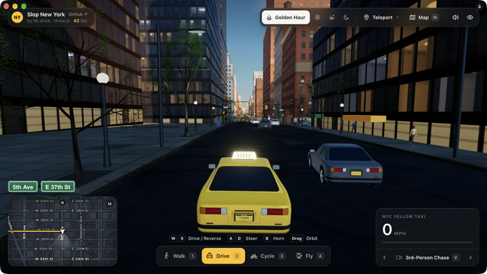

<h1 align="center">New York</h1>

Mr.doob's Slop New York: explore Manhattan on foot, by car, by bike or by helicopter.

&nbsp;&nbsp;

## Make New York yours

Each opens Lamp with a copy of New York and that change, ready to send:

- [Make it a snowy winter night](https://lamp.dev/?repo=https://github.com/lampdotdev/newyork&from=readme&ask=Make%20it%20a%20snowy%20winter%20night)
- [Make it a lot more fun](https://lamp.dev/?repo=https://github.com/lampdotdev/newyork&from=readme&ask=Make%20it%20a%20lot%20more%20fun)
- [Move the city to the Moon](https://lamp.dev/?repo=https://github.com/lampdotdev/newyork&from=readme&ask=Move%20the%20city%20to%20the%20Moon)

## Open it in Lamp

[Lamp](https://lamp.dev) is a Mac app that builds apps from a description and changes them as you ask. [Open New York in Lamp](https://lamp.dev/?repo=https://github.com/lampdotdev/newyork&from=readme) for a copy of your own, to use and to change as you like, with the credits below kept. Or, in Lamp, choose File → Open from GitHub… and paste `https://github.com/lampdotdev/newyork`.

## Building it

Lamp builds this kind of app: it needs Xcode and signing on your Mac, which Lamp sets up. Open it in Lamp, above.

## Credits

- Based on [Slop New York](https://github.com/mrdoob/slop-newyork) by Mr.doob, MIT, at commit `13dd142b480b` (license: `LICENSE-slop-newyork`)
- Uses [Map data](https://www.openstreetmap.org/copyright) by OpenStreetMap contributors, ODbL-1.0
- Uses [NYC Open Data](https://opendata.cityofnewyork.us/overview/#termsofuse) by City of New York, LicenseRef-NYC-Open-Data
- Uses [Terrain Tiles](https://registry.opendata.aws/terrain-tiles/) by Mapzen, USGS, LicenseRef-USGS-Public-Domain
- Uses [MTA Subway Entrances and Exits](https://data.ny.gov/Transportation/MTA-Subway-Entrances-and-Exits-2024/i9wp-a4ja) by Metropolitan Transportation Authority, LicenseRef-NY-Open-Data

Map data is ODbL-1.0: it stays under that licence, credited, in this remix.

NYC Open Data is used under its own terms (LicenseRef-NYC-Open-Data).

Terrain Tiles is used under its own terms (LicenseRef-USGS-Public-Domain).

MTA Subway Entrances and Exits is used under its own terms (LicenseRef-NY-Open-Data).

## License

MIT. See [LICENSE](LICENSE).
